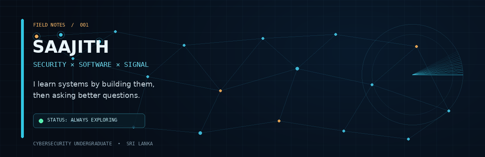
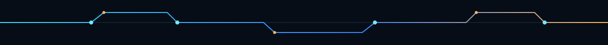

<div align="center">



<br/>

**CYBERSECURITY  /  SOFTWARE ENGINEERING  /  AI & EMBEDDED SYSTEMS**

<sub>Independent learner from Sri Lanka · building at the intersection of systems and curiosity</sub>

</div>



## `01 / About the operator`

I’m **Saajith** — a cybersecurity undergraduate who likes understanding what happens beneath the interface: how systems communicate, where they fail, and how thoughtful software can make them better.

I learn by building, testing, documenting, and iterating. My interests move between defensive security, practical development, machine learning, and small connected devices.

```text
CURRENT MODE  ──────────────────────────────────────────────
  [ learning ]   security + networking + digital forensics
  [ building ]   tools and full-stack projects
  [ exploring ]  AI/ML, BLE and ESP32
  [ principle ]  understand it; don't just copy it
```

## `02 / The workbench`

<table>
<tr>
<td width="50%" valign="top">

### `SECURITY LAB`
**Observe → investigate → understand**

- Network traffic analysis
- Linux and security labs
- Digital forensics fundamentals
- Ethical testing in controlled environments

</td>
<td width="50%" valign="top">

### `BUILD STUDIO`
**Prototype → test → improve**

- Python and JavaScript
- React and Django
- Data analysis and ML fundamentals
- ESP32 / Bluetooth Low Energy experiments

</td>
</tr>
</table>

## `03 / Selected builds`

<table>
<tr>
<td width="34%" valign="top">

**01 — BLE SENTINEL**

A hands-on BLE exploration project using ESP32 hardware, focused on discovery and wireless security concepts.

[Open repository ↗](https://github.com/Saajith2004/ble-sentinel)

</td>
<td width="33%" valign="top">

**02 — SOC DASHBOARD**

A security-focused dashboard project exploring monitoring and the presentation of security information.

[Open repository ↗](https://github.com/Saajith2004/soc-dashboard)

</td>
<td width="33%" valign="top">

**03 — ALTRIUM**

A Django-based hiring platform exploring recruitment workflows and application management.

[Open repository ↗](https://github.com/Saajith2004/altrium-hiring-platform-v1)

</td>
</tr>
</table>


## `04 / Toolkit`

<div align="center">

**CODE**


**BUILD**


**INVESTIGATE**


**EXPLORE**


</div>

<sub>Toolkit reflects areas I work with or am learning—not a claim of expert-level proficiency in every tool.</sub>

## `05 / Live telemetry`

<div align="center">


</div>

<sub>Telemetry is provided by a third-party service and may occasionally be unavailable or cached.</sub>

## `06 / Next coordinates`

- Deepen practical cybersecurity and digital forensics skills.
- Ship more useful software, not just tutorials.
- Keep exploring AI/ML and connected-device security.
- Write clear notes so future-me—and other learners—can follow the trail.


<div align="center">

**I’m less interested in looking like an expert than in becoming useful.**

<sub>`stay curious` &nbsp; / &nbsp; `verify assumptions` &nbsp; / &nbsp; `ship small things`</sub>

<br/>

[GitHub repositories](https://github.com/Saajith2004?tab=repositories) &nbsp; · &nbsp; [Connect on LinkedIn](https://www.linkedin.com/)

</div>
